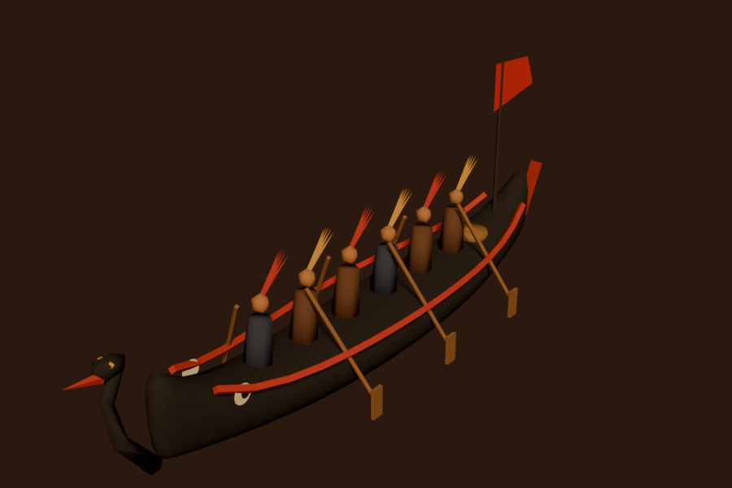

<div align="center">

# Lược sử Việt Nam

**Học lịch sử Việt Nam qua những câu chuyện 3D tương tác.**
Dự án mở của cộng đồng: ai cũng có thể góp một chương, một dòng sửa, một nguồn sử liệu.

[▶ Xem trực tuyến](https://luocsu.u3ih.io.vn) · [Các chương](#các-chương) · [Cùng đóng góp](CONTRIBUTING.md) · [Hướng dẫn cho AI agent](AGENTS.md)



</div>

---

## Ý tưởng

Sách sử thường kể bằng mốc năm. Ở đây, mỗi chương là **một khoảnh khắc lịch sử dựng lại bằng hình ảnh, âm thanh và chính đôi tay người xem**:

- Cuộn trang để máy quay bay qua dòng sông Bạch Đằng năm 938.
- Kéo thanh thủy triều để thấy nước rút, bãi cọc lộ ra, thuyền giặc mắc cọc.
- Nghe giọng kể, tiếng trống đồng và câu đàn bầu ngũ cung.

Mỗi chương có **hai phiên bản từ cùng một nguồn**:

| Bản chữ | Bản trực quan |
|---|---|
| File Markdown, đọc ngay trên GitHub | Trang web 3D tương tác |
| Dễ đọc, dễ sửa, dễ trích dẫn | Trải nghiệm, nhập vai |

Người viết sử chỉ cần sửa file Markdown. Web tự cập nhật theo.

## Các chương

| # | Chương | Thời kỳ | Bản chữ | Bản trực quan |
|---|---|---|---|---|
| I | **Bạch Đằng** (938) | Kết thúc Bắc thuộc | [📜 Đọc](content/01-bach-dang-938/story.md) | [▶ Xem](https://luocsu.u3ih.io.vn/chuong/bach-dang-938) |
| II | Chiếu dời đô (1010) | Nhà Lý | _đang chờ người viết_ | |
| III | Phòng tuyến Như Nguyệt (1077) | Nhà Lý | _đang chờ người viết_ | |
| IV | Bạch Đằng lần nữa (1288) | Nhà Trần | _đang chờ người viết_ | |
| V | Hội thề Lũng Nhai (1416) | Khởi nghĩa Lam Sơn | _đang chờ người viết_ | |
| VI | Ngọc Hồi – Đống Đa (1789) | Tây Sơn | _đang chờ người viết_ | |

Muốn nhận viết một chương? [Mở đề xuất chương](../../issues/new?template=de-xuat-chuong.yml).

## Cùng viết lịch sử 🇻🇳

Dự án sống nhờ cộng đồng. Bạn không cần biết lập trình để đóng góp:

| Bạn là… | Bạn có thể |
|---|---|
| **Người yêu sử, giáo viên, học sinh** | Sửa câu chữ, thêm ghi chú "Bạn có biết?", viết chương mới, ngay trên GitHub |
| **Người nghiên cứu sử** | Thẩm định nội dung, bổ sung nguồn, [báo chỗ chưa chính xác](../../issues/new?template=bao-sai-su-lieu.yml) |
| **Họa sĩ 3D** | Làm model bằng Blender: thuyền, nhà, trang phục, vũ khí… theo đúng thời kỳ |
| **Lập trình viên** | Dựng cảnh, thêm tương tác, cải thiện hiệu năng và trợ năng |
| **Người lồng tiếng** | Thu giọng kể cho từng phân cảnh |

👉 Bắt đầu tại **[CONTRIBUTING.md](CONTRIBUTING.md)**. Mọi đóng góp, dù nhỏ, đều được ghi nhận.

## Chạy trên máy

Cần Node.js 22+ và pnpm.

```bash
pnpm install
pnpm dev                 # http://localhost:3000
```

Dựng lại model 3D (không bắt buộc, vì model đã có sẵn trong `public/models/`):

```bash
pnpm assets              # cần Blender 5.x
```

## Cấu trúc

```
content/        nội dung từng chương: story.md (lời kể) + cảnh 3D
src/core/       bộ khung dùng chung: engine 3D, thành phần cảnh, giao diện, âm thanh
blender/        script dựng model 3D bằng Blender
public/models/  model đã tối ưu cho web
```

Chi tiết kiến trúc: [AGENTS.md](AGENTS.md). Định dạng nội dung: [content/README.md](content/README.md). Model 3D: [blender/README.md](blender/README.md).

## Công nghệ

Next.js 16 · React 19 · Three.js · GSAP · Lenis · Blender · gltf-transform. Chỉ có frontend: build ra trang tĩnh, deploy lên Vercel. Không có backend, không thu thập dữ liệu người dùng.

**Hiệu năng:** chữ render sẵn phía server và hiện ngay. Cảnh 3D tải sau, tự hạ chất lượng trên máy yếu. Toàn bộ model của một chương khoảng 400 KB.

## Deploy

1. Import repo vào [Vercel](https://vercel.com/new). Framework tự nhận Next.js, không cần cấu hình thêm.
2. (Tuỳ chọn) Đặt biến môi trường `NEXT_PUBLIC_SITE_URL` bằng tên miền chính thức.
3. Sửa `repo` trong `src/site.config.ts` và đường dẫn nút "Xem trực quan" trong các `story.md` nếu đổi tên miền.

## Lưu ý về nội dung

Nội dung dựa trên chính sử (Đại Việt sử ký toàn thư, Việt sử lược, Khâm định Việt sử thông giám cương mục…) và kết quả khảo cổ đã công bố. Dự án đang trong giai đoạn thử nghiệm, nội dung cần chuyên gia thẩm định. Nếu thấy chỗ chưa chính xác, hãy [báo cho chúng tôi](../../issues/new?template=bao-sai-su-lieu.yml).

## Giấy phép

- **Mã nguồn:** [MIT](LICENSE).
- **Nội dung** (lời kể, giọng đọc, model 3D): [CC BY-SA 4.0](LICENSE-CONTENT.md). Bạn được dùng lại, kể cả thương mại, miễn là ghi công và chia sẻ bản phóng tác theo cùng giấy phép.
